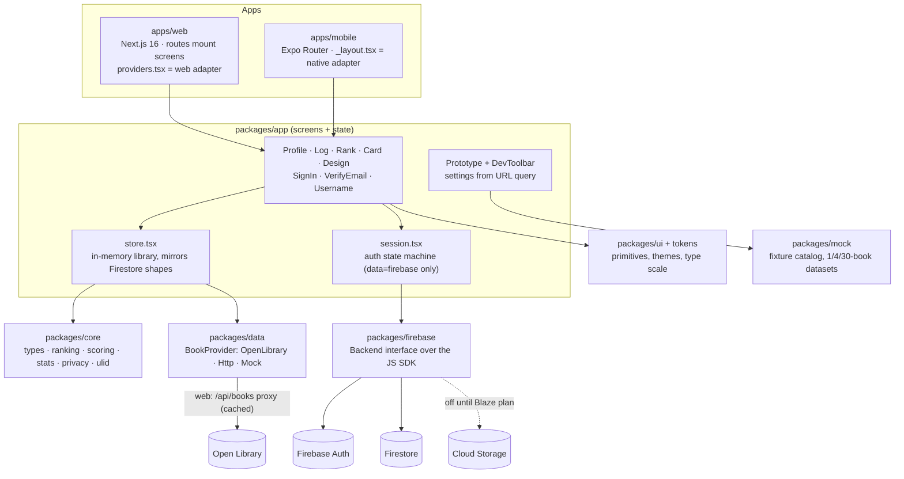
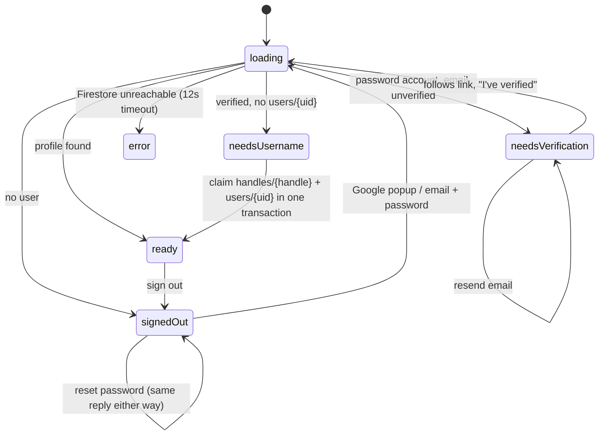
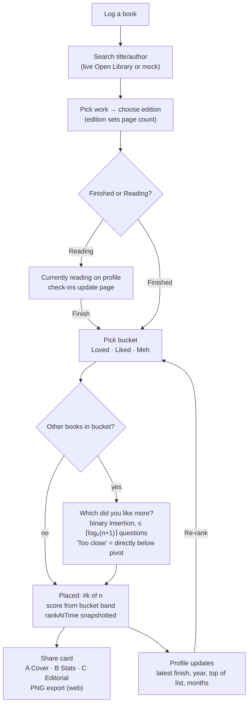
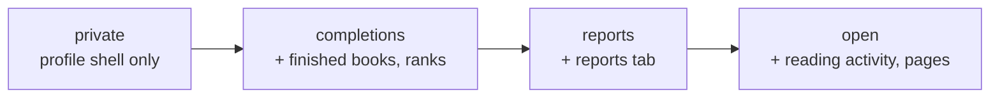
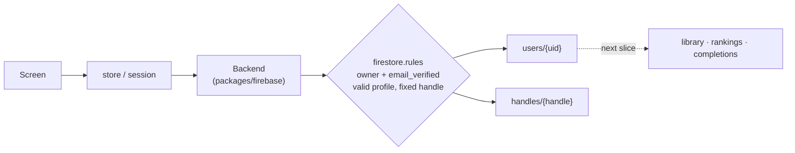

# Workflows

How Sartre fits together and how a reader moves through it. Diagrams are Mermaid
(GitHub renders them). Keep this in step with the code when flows change.

## 1. Architecture

Routes are thin: both apps mount the same shared screens from `@sartre/app`.
Shared code never imports Firebase or Next/Expo directly.

## 2. Sign-in and onboarding (`data=firebase`)

`session.tsx` derives the step from the signed-in user. Every Firestore write
requires a verified email, and the username is permanent.

## 3. Logging and ranking a book

## 4. Who sees what (privacy dial)

The owner always sees everything. Planned: a Cloud Function writes the public
projection `profiles/{uid}` according to this dial, since rules can't hide fields.

## 5. Firebase data path

Today only the profile lives in Firestore. Books, rankings and completions are still
in memory in every mode.
